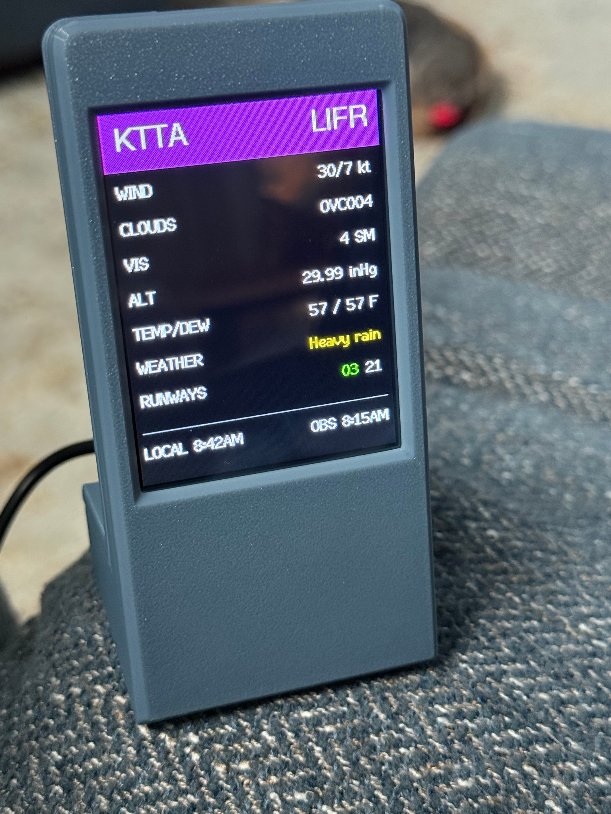

# METAR Mini

**A compact, Wi-Fi-connected aviation weather display for the ESP32 Cheap Yellow Display (CYD).**

METAR Mini cycles through your selected airports, presenting current reported weather in a readable, color-coded format. Configure it from a phone or computer without editing firmware.

[IFR display example](Images/METAR_Mini_IFR.jpg) · [Rear enclosure and power connection](Images/Rear_Enclosure.jpg)

## Features

- Up to 20 airports; automatic rotation every 3–30 seconds (default 5).
- Color-coded flight categories: VFR green, MVFR blue, IFR red, LIFR magenta.
- Wind, clouds, visibility, altimeter, temperature/dew point, reported weather and runway identifiers.
- Automatic runway lookup, filtering and manual runway entry; green highlight for the runway end with the greatest calculated positive headwind.
- Local clock and local or UTC METAR observation time; 12/24-hour clock; Fahrenheit or Celsius.
- Touchscreen navigation and password-free local setup portal.
- Saved settings and cached runway data; METAR requests approximately every five minutes in normal operation.

## Hardware

| Item | Quantity | Notes |
|---|---:|---|
| ESP32-2432S028R (CYD) | 1 | 2.8-inch 240 × 320 ILI9341 display, XPT2046 resistive touch, classic ESP32 |
| USB data/power cable | 1 | Match board connector; USB-A to USB-C is a useful option for USB-C CYD revisions |
| 5 V USB power supply | 1 | Regulated; 1 A or greater recommended |
| 90-degree USB-C adapter | Optional | For neat cable routing; check physical fit |
| 3D printed enclosure | 1 | See options below |
| M2 × 5 mm screws | As required | Included enclosure designer specifies these |

No external weather sensor or additional wiring is required. Other CYD display-controller revisions may need different settings and are not validated here.

## Installation and operation

1. Follow [Installation and compilation](docs/INSTALLATION.md) to install Arduino IDE dependencies, configure TFT_eSPI and upload the sketch.
2. On first boot, connect to `METAR-Setup` from your phone (no password), and open `http://192.168.4.1/`.
3. Enter airport IDs, select your Wi-Fi network, enter its password, and choose your preferences. Save and restart.
4. See [Operating guide](docs/USER_GUIDE.md) for runway settings and touchscreen navigation.

## 3D-printed enclosures

### Included: Weather Station Case CYD ESP32-2432S028 + BME280

Designed by Giuseppe (Peppe) Minniti. The original [3MF file](Enclosures/Meteo%20Common%20Share.3mf) is provided unchanged under its original Creative Commons Attribution license. See [enclosure credits](Enclosures/README.md). A BME280 sensor is not needed for METAR Mini.

### Preferred: Aura – Smart Weather Forecast Display

The project author's preferred angled desktop enclosure is available from [MakerWorld](https://makerworld.com/en/models/1382304-aura-smart-weather-forecast-display?from=search#profileId-1430975). Its design files are not redistributed here. A compact right-angle USB adapter can simplify rear cable routing.

## Data and acknowledgments

- METAR observations: [NOAA Aviation Weather Center](https://aviationweather.gov/data/api/).
- Runway data: [OurAirports](https://ourairports.com/data/).
- Libraries: [TFT_eSPI](https://github.com/Bodmer/TFT_eSPI), [ArduinoJson](https://arduinojson.org/), [XPT2046_Touchscreen](https://github.com/PaulStoffregen/XPT2046_Touchscreen), and [Arduino ESP32](https://github.com/espressif/arduino-esp32).
- Developed by Ron Earp with AI-assisted programming and documentation using ChatGPT.

## Important aviation and security limitations

METAR Mini is an informational desktop display, not certified avionics or a substitute for an official weather briefing, current charts, NOTAMs, ATIS or pilot judgment. Reports may be stale, missing or incorrect. Verify observations and their timestamps independently. Runway highlighting is a wind-only calculation, not an operational runway recommendation. Manual runway headings are approximated from runway numbers (magnetic convention), whereas METAR winds and downloaded headings are true; magnetic variation can affect the result. The software does not account for closures, runway length, surface conditions or aircraft limitations.

The setup access point is unprotected and the firmware does not verify HTTPS server certificates. Use setup only in a trusted setting and do not treat fetched data as authenticated. Wi-Fi credentials are saved on the device.

## Software licensing and commercial use

METAR Mini is a free, community-oriented project for aviation enthusiasts, pilots and makers. The project-authored firmware is licensed under the [PolyForm Noncommercial License 1.0.0](https://spdx.org/licenses/PolyForm-Noncommercial-1.0.0.html). See [LICENSE](LICENSE) for the license reference and required notice.

You are welcome to build units for personal use or gifts, and to use, modify and share the firmware subject to the license terms. Commercial manufacture and sale of devices incorporating the firmware are not authorized without separate written permission from the copyright holder. The governing license terms control over this summary.

The software is source-available, not OSI-approved open source. Third-party enclosure and library licenses remain separate.

Required Notice: Copyright 2026 Ron Earp (https://github.com/ronearp/Metar-Mini)

See [release notes](docs/RELEASE_NOTES.md).
