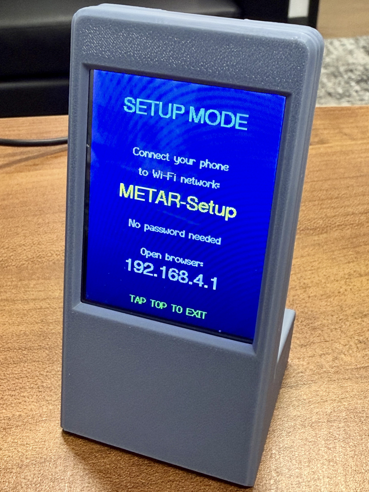
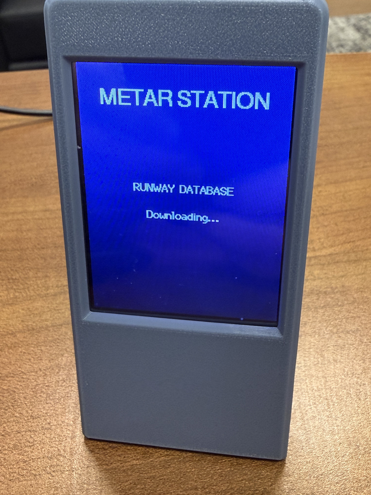
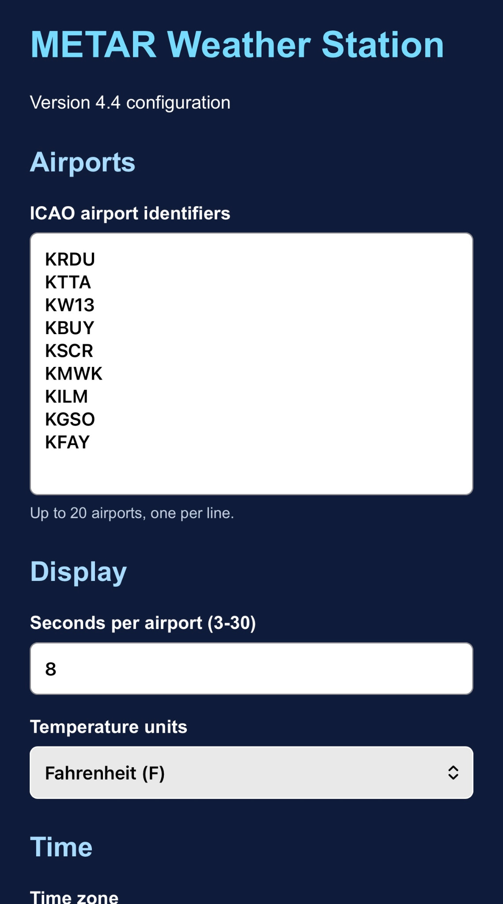
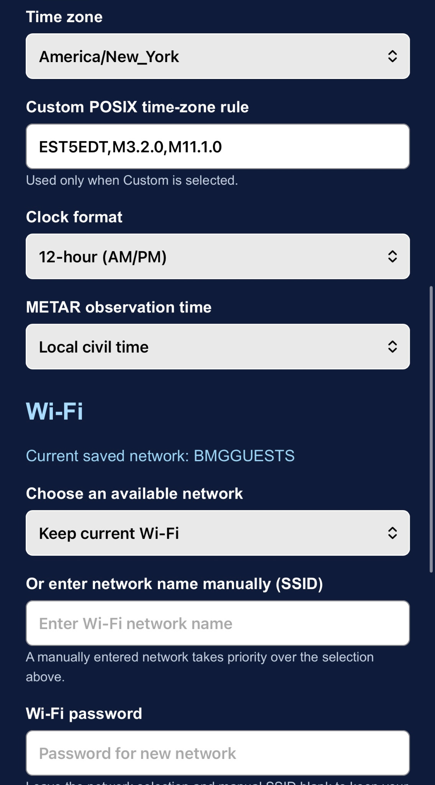

# Operating guide

## Configure

Tap the bottom quarter of the display to enter setup. Join `METAR-Setup` (no password), then visit `http://192.168.4.1/`. Enter up to 20 airport identifiers, one per line. Choose a network from the scan or enter its SSID manually (manual entry takes priority). Enter the password for a newly selected network. Leave both network selections blank to retain credentials. Refresh the scan if necessary. Set rotation interval (3–30 seconds), temperature units, time zone (or custom POSIX rule), clock format and METAR observation time. Press **Save and Restart**. Tap above the bottom quarter of the setup screen to exit without saving form edits.

## Normal display

The airport banner indicates flight category: green VFR, blue MVFR, red IFR, magenta LIFR; gray for unknown. The display cycles automatically; tap above the bottom quarter to advance immediately. Wind is displayed as direction @ speed in knots, with gusts when reported. Clouds retain METAR notation (e.g. OVC004 means overcast at 400 ft above airport level). VIS is reported visibility, ALT is altimeter setting, TEMP/DEW is temperature and dew point, WEATHER is reported conditions, and RUNWAYS shows runway ends. LOCAL is the device clock; OBS or Z shows report time, not download time.

## Runway modes

- AUTO: use runway ends from the downloaded data.
- FILTER: restrict displayed runway ends to selected identifiers, e.g. `05/23,14/32`.
- MANUAL: supply runway pairs, e.g. `06/24` or `06/24,13/31`; the firmware estimates headings from runway numbers.

Runway settings appear for currently saved airports. When adding a new airport, save and restart, then reopen setup to configure its runways. Green highlights the end with the largest calculated positive headwind; calm or variable winds may have no highlight. Manual runway numbers are only approximate, and magnetic/true differences matter. Always verify actual runway suitability independently.

## Data freshness

Normal weather refresh is approximately five minutes. Failed requests may leave cached observations on screen. Always check report time and use official weather sources before flight. Initial runway retrieval may take time; runway information is cached and is not a source of current runway status.

## Setup photographs

These photographs illustrate the setup workflow; some show earlier firmware revisions.

